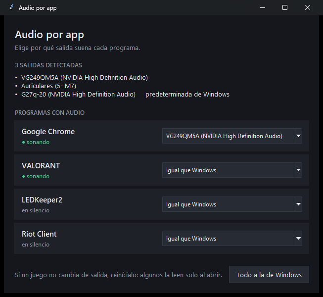

# Audio por app

Elige por qué salida de audio suena cada programa de Windows.

El juego por los audífonos y la música por el parlante Bluetooth, al mismo tiempo.



## Descargar

**[⬇ AudioPorApp.exe](https://github.com/YordySerna/audio-por-app/releases/latest/download/AudioPorApp.exe)** (Windows 10 y 11, ~10 MB)

No se instala nada: se descarga y se abre.

La primera vez Windows puede mostrar **"Windows protegió su PC"**. Aparece con
cualquier programa nuevo que no pagó un certificado de firma, no porque tenga
algo malo. Para abrirlo: **Más información → Ejecutar de todas formas**. Si
prefieres no confiar en un `.exe`, el código completo está en
[`audio_por_app.pyw`](audio_por_app.pyw) (un solo archivo) y se puede correr
con Python.

## Uso

1. Abre el programa y los juegos, navegador, etc. que quieras separar.
2. Cada programa con audio aparece en la lista. En su menú eliges la salida.
3. Listo. Windows recuerda la elección aunque cierres esta ventana o
   reinicies el PC. **No hace falta dejarlo abierto.**

Las salidas se detectan solas: si conectas un parlante Bluetooth, aparece en
unos segundos. "Todo a la de Windows" deshace todas las elecciones.

## Límites

- **Es por programa, no por pestaña.** Todo Chrome sale por la misma salida. Si
  quieres la música aparte, ábrela en otro navegador.
- **Algunos juegos leen la salida solo al abrirse.** Si no cambia al tiro,
  reinicia el juego.
- **Un programa aparece cuando abre el audio.** Si todavía no ha sonado, no está
  en la lista.
- **Audífonos Bluetooth:** si ves dos salidas del mismo aparato, elige la
  normal. La de "Manos libres" suena como llamada telefónica.

## Cómo funciona

Usa la misma función interna de Windows que la página *Configuración → Sistema
→ Sonido → Mezclador de volumen* (que también permite hacer esto, pero de a
un programa y escondido). Microsoft no la documenta. El orden de sus métodos
se tomó de [EarTrumpet](https://github.com/File-New-Project/EarTrumpet), que
la usa desde hace años. Una actualización grande de Windows podría cambiarla.

Está escrito en Python usando solo la biblioteca estándar (`ctypes` para hablar
con Windows, `tkinter` para la ventana). No tiene dependencias externas, no se
conecta a internet y no guarda nada propio: la elección la guarda Windows.

### Correrlo desde el código

Con Python 3.10 o superior:

```
py audio_por_app.pyw
```

### Construir el .exe

```
py -m pip install pyinstaller
py -m PyInstaller --onefile --windowed --name AudioPorApp --distpath dist --workpath build --specpath build audio_por_app.pyw
```

## Licencia

MIT. Hecho por [Yordy Serna](https://yordyserna.github.io).
